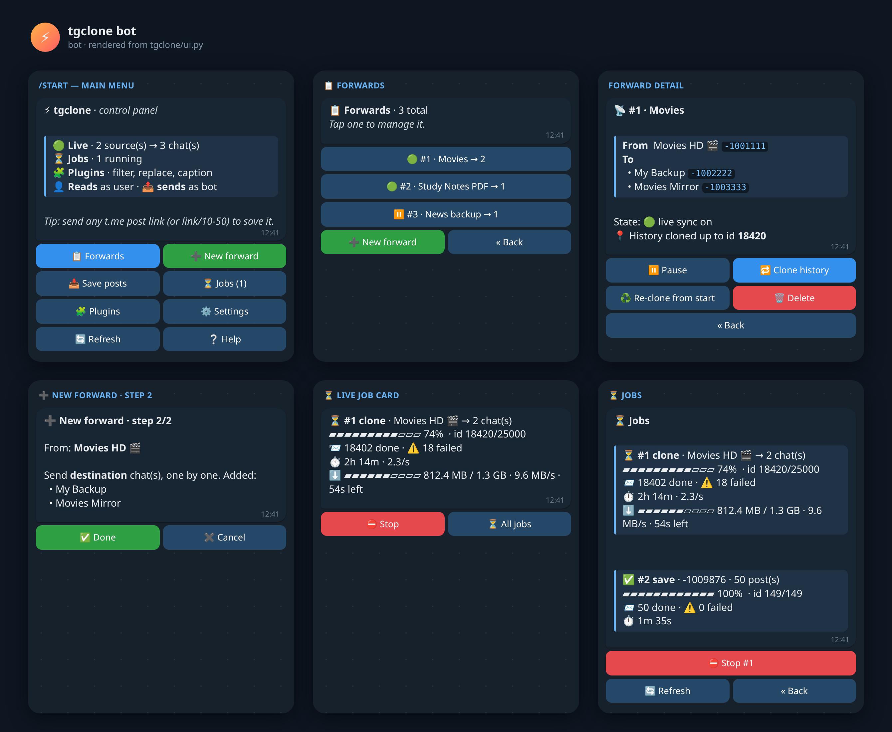
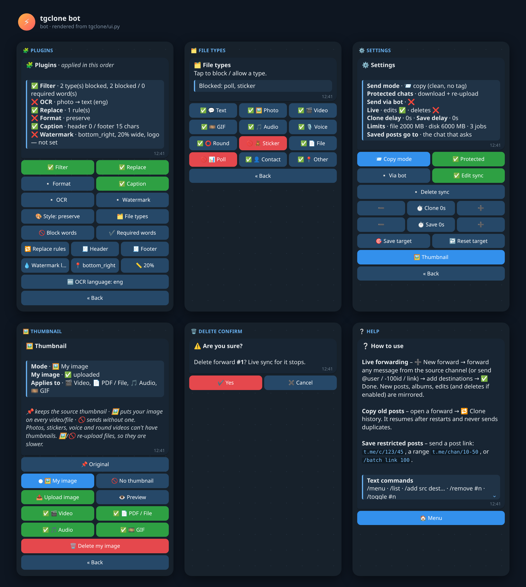
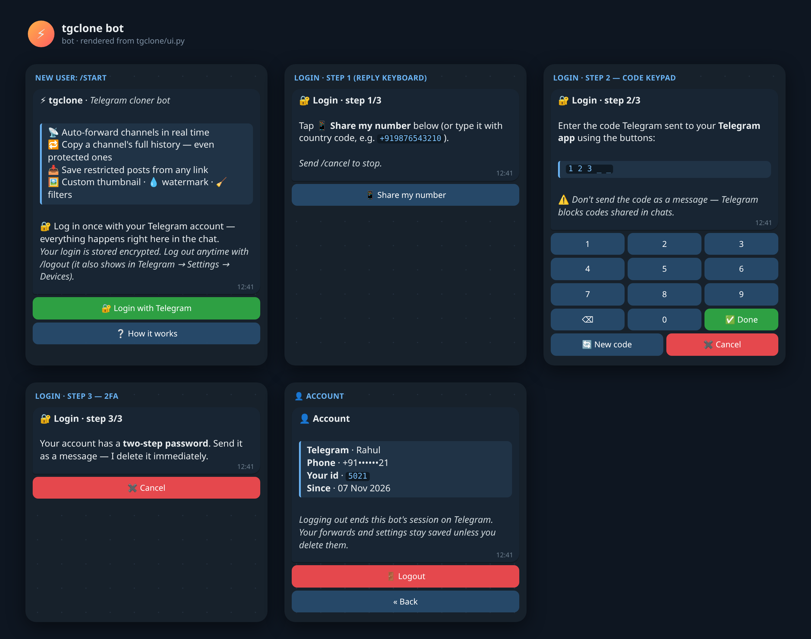
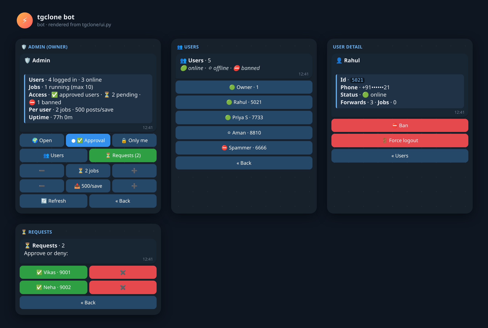
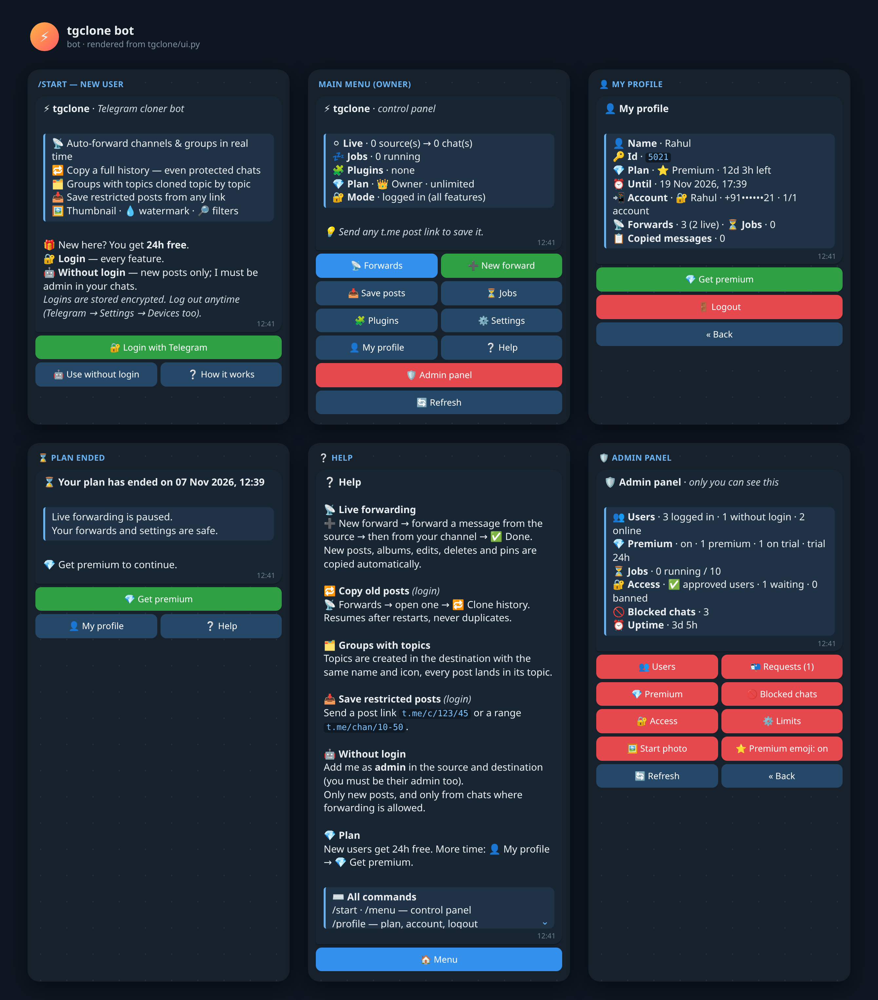
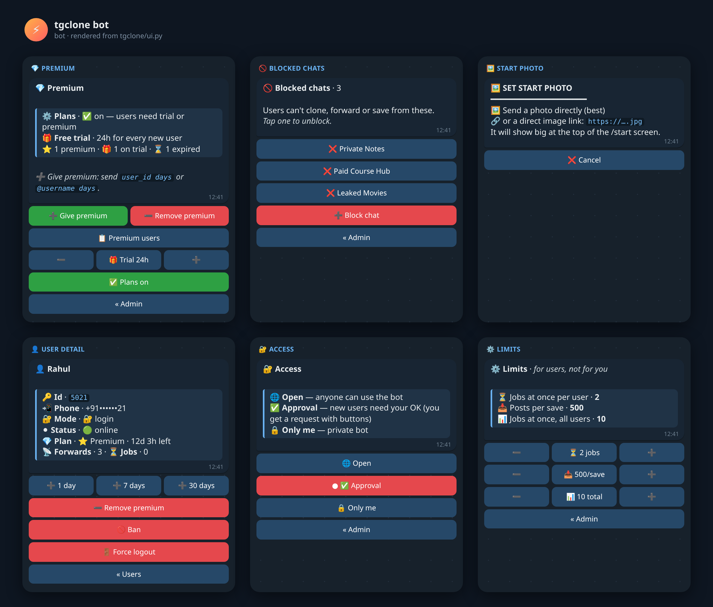

# SRC-Villan (tgclone)

One clean Telethon tool that merges **5 projects**:

| Source project | What was kept |
|---|---|
| tgcf | live sync (new/edit/delete), past mode, plugins (filter, replace, fmt, caption, ocr, watermark), admin commands |
| Telethon-Channel-Clone | full history copy + batch pause (`past.batch_size` / `past.batch_sleep`) |
| clonechat | protected-content clone (download + re-upload), resume, file-type filter, per-message delay |
| Save-Restricted-Content-Bot v2 / v3 | save posts from `t.me` links (public, private `/c/`, topic links), `/batch`, `/stop`, save target chat |

**Multi-user bot**: anyone can use it from Telegram alone. Users log in inside the bot (📱 share number → code on a button keypad → 2FA). Every user gets their own forwards, settings, thumbnail, logo and jobs. Saved logins are encrypted (Fernet). The owner gets an 🛡 Admin panel: open / approval / private mode, ban, force logout, per-user limits.

Not kept (on purpose): premium/payment/redeem codes, ad shortener, `/eval` (remote code execution),
speedtest, broadcast, yt-dlp downloader, MongoDB, Dropbox-hosted pyrogram forks and
`devgagantools` (unverifiable dependencies), obfuscated promo strings.

## Screenshots








## Ubuntu quick start

**Full step-by-step guide (Hinglish): [docs/UBUNTU_SETUP.md](docs/UBUNTU_SETUP.md)**

```bash
git clone -b ccr-1f6db1cf-flau3n https://github.com/Ownermood/SRC-Villan-.git && cd SRC-Villan-
bash scripts/install_ubuntu.sh --service   # packages + venv + systemd service
.venv/bin/python -m tgclone setup          # 4 questions -> .env (owner, once)
sudo systemctl start tgclone               # runs 24x7 -> open your bot -> /start -> 🔐 Login
```
Users never touch a terminal. They open the bot, log in and use the buttons.

## Setup

```bash
pip install -r requirements.txt
cp .env.example .env          # fill API_ID, API_HASH, BOT_TOKEN, ADMINS
python -m tgclone login       # prints SESSION_STRING -> put it in .env
```

The first run creates `tgclone.config.json`. Secrets stay in `.env` only; the config file has no secrets.

## Run

```bash
python -m tgclone live        # real-time sync + control panel (main mode)
python -m tgclone bot         # control panel / save bot only, no live sync
python -m tgclone past        # clone history of all enabled forwards (resumable)
python -m tgclone past --source -100111 --dest -100222      # one-off clone
python -m tgclone past --fresh                               # start over
```

Docker (restarts automatically after a crash or reboot): `docker compose up -d --build`
Logs are written to `data/tgclone.log` (rotating, 3 × 5 MB).

## Accounts

| `.env` | Result |
|---|---|
| `BOT_TOKEN` + `OWNER_ID` (recommended) | **multi-user bot**: every user logs in inside the bot. A `SESSION_STRING`, if set, becomes the owner's account. |
| `SESSION_STRING` only | old single-user userbot: `.` commands from your own account |

Per-user files: `data/users/<telegram id>/` (config.json, tgclone.db, thumbnail, logo).
Logins: `data/accounts.db` (encrypted with `SECRET_KEY` or `data/secret.key`).

## Control panel (bot)

Send `/start` to the bot. Everything works with buttons. The colored buttons need Telethon ≥ 1.45 (Telegram layer 229).

- **📋 Forwards**: list, pause or resume, clone history, re-clone from the start, delete (with a confirm step). The buttons carry a checksum, so an old menu never acts on the wrong forward.
- **➕ New forward**: a 2-step wizard. *Forward any message from the channel* and the id is detected for you. You can also send `@user`, `-100id` or a `t.me` link.
- **📥 Save posts**: send a post link or a range link (`t.me/c/123/10-60`). You can send a link at any time without opening the menu.
- **⏳ Jobs**: live progress card with a ▰▱ bar, done/failed counts, speed, ETA and the current file's ⬇️/⬆️ MB/s. Each job has its own ⛔ Stop button. Up to `max_jobs` run at once, and the same clone can never run twice.
- **🧩 Plugins**: on/off toggles (applied instantly, no restart), style switcher, file-type grid (tap to block), editors for blocked words, required words, replace rules, header and footer.
- **⚙️ Settings**: copy or forward mode, protected-chat fallback, send via bot, edit and delete sync, ➖/➕ delays, save target.
- **🖼 Thumbnail** (in Settings): 📌 keep the original, 🖼 use your own image, or 🚫 send without one. Choose the types it applies to: 🎬 video, 📄 PDF/file, 🎵 audio cover, 🎞 GIF (photos, stickers, voice and round videos can't have one). Upload by sending a photo. It is auto-converted to a Telegram-valid JPEG (≤320px, ≤200 KB). Shortcuts: send a photo with the caption `/setthumb`, or use `/delthumb`. It applies to live forwarding, history clone and saved posts, albums included. Custom/none modes re-upload files, so they are slower than a plain copy.

Text commands still work (and are the only option for a user account without a bot, using the `.` prefix):

```
/menu /list /add <src> <dest..> /remove <#n|src> /toggle <#n> /clone <#n> [fresh]
/clone <src> <dest> /batch <link> <count> /jobs /stop [id] /setchat <chat|off> /style <s> /status
/thumb /setthumb (photo caption or reply) /delthumb
```

## Config (`tgclone.config.json`)

```json
{
  "forwards": [{"name": "main", "source": -100111, "dest": [-100222], "offset": 0, "end": 0}],
  "forward_mode": false,
  "send_via_bot": false,
  "protected_fallback": true,
  "max_file_mb": 2000,
  "max_disk_mb": 6000,
  "max_jobs": 3,
  "live": {"edit_sync": true, "delete_sync": false, "delete_on_edit": ".deleteMe"},
  "past": {"delay": 1.0, "batch_size": 0, "batch_sleep": 0},
  "save": {"target": "", "use_plugins": false, "max_batch": 1000, "delay": 1.0},
  "thumb": {"mode": "original", "types": ["video", "document", "audio", "gif"]},
  "plugins": {
    "filter":  {"check": false, "users": {"blacklist": [], "whitelist": []},
                "files": {"blacklist": ["sticker"], "whitelist": []},
                "text":  {"blacklist": [], "whitelist": [], "case_sensitive": false, "regex": false}},
    "replace": {"check": false, "text": {"old": "new"}, "regex": false},
    "fmt":     {"check": false, "style": "preserve"},
    "caption": {"check": false, "header": "", "footer": ""},
    "ocr":     {"check": false, "lang": "eng", "keep_caption": true},
    "mark":    {"check": false, "image": "", "position": "bottom_right", "size": 0.2, "frame_rate": 0}
  }
}
```
File types: `text photo video gif audio voice video_note sticker document poll contact other`.

## Plans, admin panel and more (v4)

- **Free trial + premium**: every new user gets a free trial (default 24h) when they first log in or start without-login mode. After that the owner adds premium days. Days stack on top of the time left. When a plan ends, live forwarding pauses (settings are kept), the user gets a message (plus a reminder 2h before), and only 👤 My profile / 💎 Get premium stay open. You can turn plans off to make everyone free.
- **👤 My profile**: name, id, plan with time left and end date, linked account (1 per user), forwards, jobs, copied messages, logout.
- **🛡 Admin panel** (red buttons, only the owner sees it): 👥 Users (ban, force logout, ➕1/7/30 days, remove premium) · 📬 Requests · 💎 Premium (give / remove by `user_id days` or `@username days`, list, trial hours, plans on/off) · 🚫 Blocked chats · 🔐 Access (open / approval / only me) · ⚙️ Limits · 🖼 Start photo · ⭐ Premium emoji.
- **🚫 Blocked chats**: block a chat by folder link (`t.me/addlist/…`, blocks every chat in it), `@username`, `t.me/c/…`, invite `t.me/+…`, `-100…` id or a forwarded message. Users can't add it as a source, clone it or save from it. Existing live forwards from it stop.
- **🤖 Without login**: users add the bot as admin in their chats (they must be admins too) and get live forwarding of new posts. Protected chats are refused. Logging in later keeps their settings.
- **📌 Pins**: pinning and unpinning in the source is copied, and the "… pinned a message" notice in the destination is deleted at once. A history clone copies pins too.
- **🖼 Start photo**: send a photo or an https image link in 🛡 Admin → Start photo. It shows big on top of /start.
- **⭐ Premium emoji**: every screen and button uses the animated UI pack. If Telegram doesn't allow the bot to use custom emoji, it falls back to normal emoji automatically. You can switch this in the admin panel.
- Owner commands: `/admin`, `/addpremium <id|@user> <days>`, `/rmpremium <id>`, `/block <chat|link|folder>`, `/unblock <chat>`.

## Reliability (v4.1)

- **Auto-resume**: a clone or save that was running when the bot stopped (crash, restart, Ctrl+C) continues by itself on the next start, from where it stopped. Only ⛔ Stop forgets it.
- **No limits by default**: no file size cap (Telegram itself allows 2 GB, or 4 GB with premium), no posts-per-save cap. A single file bigger than the temp-disk cap still goes through.
- **Polls and quizzes** are copied (a quiz nobody answered is copied as a normal poll, because its answer is hidden).
- **Premium emoji in source posts**: accounts without Telegram Premium can't send them, so they are sent as normal emoji instead of failing.
- `scripts/run.sh` restarts the bot after a crash and prints why it stopped. A crash traceback is always written to `data/tgclone.log`.

## Groups with topics (forums)

Clone a group with topics into another group and each topic is recreated automatically:
- Topics are created in the source's order with the same title, colour and icon. A premium emoji icon falls back to a colour if refused. A closed topic stays closed.
- Every post goes into its own topic. Replies stay replies, and albums stay together. General goes to General.
- Live: a new topic in the source is created in the destination right away. Renaming, closing or reopening a topic is mirrored too.
- Restarts, resumes and 🔁 re-clones reuse the same topics (no duplicates).
- If the destination has no topics, the bot turns them on when it is allowed to. Otherwise posts go in without topics.
- Needed: the sending account must be an **admin with "Manage topics"** in the destination.
- Switch: ⚙️ Settings → 🗂 Topics (`"topics": {"enabled": true, "auto_enable_forum": true, "sync_edits": true}`).

## Behaviour notes

- Re-uploaded files keep their original thumbnail, file name, duration and voice/round flags.
- `max_disk_mb` is a soft cap on temporary downloads. When it is full, new downloads wait for running jobs to free space.
- Edit sync ignores reaction and view-count updates. If the media itself was replaced, the new media is synced too.

## OCR & watermark plugins

Both need a system program. The Docker image already includes them.

```bash
sudo apt install ffmpeg tesseract-ocr tesseract-ocr-hin   # Ubuntu/Debian VPS
pkg install ffmpeg tesseract                              # Termux
```

- **OCR**: reads text from photos and adds it under the caption (`keep_caption`). The language is set from the panel (`eng`, `eng+hin`, `hin`). It runs in a thread, so the bot never freezes.
- **Watermark**: in the panel, tap 🧩 Plugins → 💧 Watermark logo and send a PNG *as a file* to keep transparency. 📍 sets the position and 📏 sets the size (% of the width). Videos keep their audio and duration. ffmpeg runs async, with a 30-minute limit per file.
- If a program is missing, the plugin shows "⚠️ Not loaded" and everything else keeps working.

## Tests

```bash
pip install pytest && python -m pytest -q tests
```
The tests run offline with fake clients. They cover sending (copy, forward, protected, album, thumbnail, progress), resume and dedup, jobs, live edit and delete, the control panel flows, and real Telethon serialization of every screen.

## Data

`data/tgclone.db` (SQLite) stores the source→dest message map (used for reply, edit and delete sync)
and past-mode progress. Restarts resume without duplicates. Temporary downloads go to `data/downloads`
and are deleted after sending.
