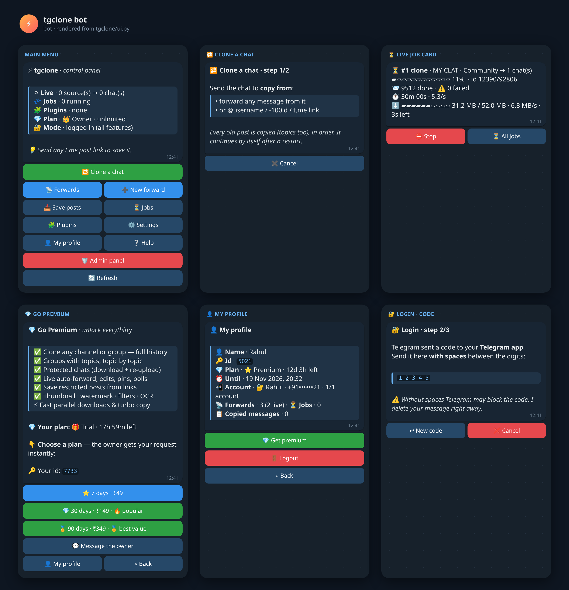
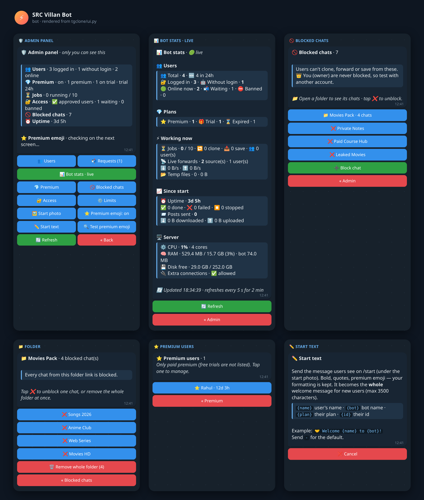
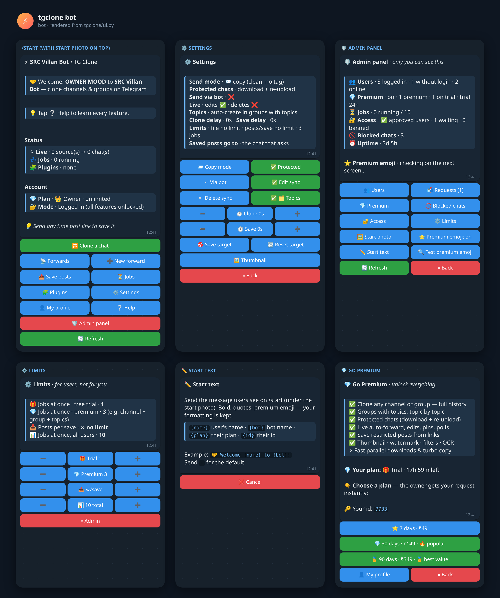

# SRC-Villan (tgclone)

A Telegram cloner bot built on Telethon. Users work **inside Telegram only**: they log in in the bot, clone channels or groups (protected ones and groups with topics too), auto-forward new posts, and save restricted posts from links. The owner runs it on a server and manages users from an 🛡 Admin panel.

It was built by merging **tgcf**, **Telethon-Channel-Clone**, **clonechat** and **Save-Restricted-Content-Bot v2/v3** into one codebase. Left out on purpose: payment / redeem code, ad shortener, `/eval` (remote code execution), speedtest, broadcast, yt-dlp, MongoDB, Dropbox-hosted pyrogram forks and other unverifiable dependencies, and obfuscated promo strings.





## Quick start (owner, once)

Full Hinglish guide with troubleshooting: **[docs/UBUNTU_SETUP.md](docs/UBUNTU_SETUP.md)**

```bash
git clone -b ccr-1f6db1cf-flau3n https://github.com/Ownermood/SRC-Villan-.git && cd SRC-Villan-
bash scripts/install_ubuntu.sh --service   # python, ffmpeg, tesseract, .venv (+ systemd if available)
.venv/bin/python -m tgclone setup          # asks API_ID, API_HASH, BOT_TOKEN, OWNER_ID -> .env
tmux new -s tgclone 'bash scripts/run.sh'  # or: sudo systemctl start tgclone
```
Then open the bot and send `/start`. `scripts/run.sh` restarts the bot after a crash and prints why it stopped.
Update: `git pull && .venv/bin/pip install -r requirements.txt -q`, then restart. Running jobs continue by themselves.

## For users (everything in Telegram)

1. `/start` → **🔐 Login with Telegram** → 📲 share your number → send the code **with spaces** (`1 2 3 4 5`) → 2FA password if you have one (deleted at once).
2. **🔁 Clone a chat** → send the source (forward a message from it, or `@username` / `-100id` / link) → send the destination → the clone starts.
3. **➕ New forward** does the same for live auto-forwarding of new posts.
4. Send any post link (`t.me/c/123/45`, or a range `t.me/chan/10-50`) to save it.

**🤖 Use without login** also works: add the bot as admin in both chats (you must be their admin too). This copies new posts only, and only from chats where forwarding is allowed.

## Features

**Cloning & speed**
- Full history, oldest first, albums kept together, replies linked, pins copied (the "pinned a message" notice is deleted at once), polls and quizzes copied.
- **Turbo copy**: plain posts are copied server-side, **100 per request**, with no download and no "Forwarded from" tag.
- **Protected chats**: each file is downloaded and re-uploaded, keeping its thumbnail, name and duration. Big files (10 MB and up) use **4 connections × 4 parts in flight** (512 KB parts). The next files download while the current one uploads, and several destinations are sent at the same time (the file is downloaded once).
- **Fast restart**: the bot answers at once, users load in parallel, the chats a user works with are remembered (no full dialog download), and pending jobs resume within a second.
- No fixed pause between posts. If Telegram asks to wait (FloodWait), the bot waits and continues.
- **Resumable**: progress is stored. A stopped, crashed or restarted clone continues by itself, and nothing is sent twice.

**Groups with topics**: topics are created in the destination with the same name, colour and icon, and every post lands in its topic. New topics, renames and close/reopen are mirrored live. The sending account needs *admin + Manage topics* in the destination.

**Live forwarding**: new posts, albums, edits (including replaced media), deletes (optional) and pins.

**Per user**: custom thumbnail (keep, own image, or none), watermark logo (ffmpeg), OCR (tesseract, eng/hin), filters (users, file types, words), replace rules, header/footer, text style. Each user has their own settings, files and jobs in `data/users/<id>/`.

**Plans & admin (owner only, red 🛡 Admin panel button)**
- Every new user gets a free trial (default 24h). **💎 Go Premium** shows the plans and prices you set (`7=₹49, 30=₹149, …`). A tap sends you a request with a one-tap **✅ Grant** button, and the user sees your payment info.
- Users: approve / ban / force logout, add 1/7/30 days, remove premium. You can also use `/addpremium <id|@user> <days>` and `/rmpremium <id>`.
- 🚫 Blocked chats: block by folder link `t.me/addlist/…`, `@username`, `t.me/c/…`, invite `t.me/+…` (only once you have joined it), `-100…` id or a forwarded message.
- Access mode (open / approval / only me). Jobs at once: free trial 1 and premium 3 (e.g. a channel, a group and a topics group together), both adjustable.
- Start screen: start photo plus your own ✏️ start text (`{name}` `{bot}` `{plan}` `{id}`; your bold, quotes and premium emoji are kept). Also ⭐ premium emoji and 🔍 premium emoji self-test.

**Every Telegram style is copied**: quote and expandable quote, bold, italic, underline, strike, spoiler, code, pre, links, mentions and premium emoji, even after caption / replace / style plugins change the text.

**Buttons**: one premium icon per button. « Back / Cancel are red, settings that are ON are green, everything else is blue.

**Premium emoji**: every screen and button uses the animated UI pack. Telegram rule (Bot API, Feb 2026): a bot can show custom emoji only if **the account that owns the bot in @BotFather has Telegram Premium**. Use 🔍 *Test premium emoji* in the admin panel to see what Telegram does.

## Commands

```
/start /menu /profile /login /logout /help
/list /add <src> <dest..> /remove <#n|src> /toggle <#n> /clone <#n> [fresh] /clone <src> <dest>
/batch <link> <count> /jobs /stop [id] /setchat <chat|off> /style <s> /status
/thumb /setthumb (photo caption or reply) /delthumb
owner: /admin /addpremium <id|@user> <days> /rmpremium <id> /block <chat|link|folder> /unblock <chat>
```

## Configuration

`.env` holds the secrets only. `python -m tgclone setup` writes it with permission 600:

| Key | Meaning |
|---|---|
| `API_ID`, `API_HASH` | from https://my.telegram.org |
| `BOT_TOKEN` | from @BotFather |
| `OWNER_ID` | your Telegram id (gets the admin panel) |
| `SECRET_KEY` | encrypts saved logins. **Back it up**: without it users must log in again |
| `SESSION_STRING` | optional, old single-user mode (normally empty) |

Each user's settings live in `data/users/<id>/config.json` and are changed from the bot. The main defaults are below:

```json
{
  "forward_mode": false, "send_via_bot": false, "protected_fallback": true,
  "premium_emoji_via_bot": true, "max_file_mb": 0, "max_disk_mb": 6000, "max_jobs": 3,
  "live":  {"edit_sync": true, "delete_sync": false, "pin_sync": true},
  "past":  {"delay": 0, "turbo": true, "prefetch": 3},
  "save":  {"target": "", "max_batch": 0},
  "thumb": {"mode": "original", "types": ["video", "document", "audio", "gif"]},
  "topics": {"enabled": true, "auto_enable_forum": true, "sync_edits": true}
}
```
`0` means no limit. Plugin settings (`filter`, `replace`, `fmt`, `caption`, `ocr`, `mark`) are set in 🧩 Plugins.

## Files & security

| Path | What |
|---|---|
| `data/accounts.db` | logins (Fernet-encrypted), plans, block list, admin settings |
| `data/users/<id>/` | that user's config, message map / progress db, thumbnail, logo |
| `data/tgclone.log` | log (rotating 3 × 5 MB); crashes are always written here |
| `data/downloads/` | temporary files, deleted after sending |

Never share `.env`, a `SESSION_STRING` or `data/accounts.db`. If a session string ever leaks, end that session in Telegram → Settings → Devices.

## Run modes

```bash
python -m tgclone live      # the bot + live forwarding (normal)
python -m tgclone bot       # the bot without live forwarding
python -m tgclone past [--source X --dest Y] [--fresh]   # clone from the terminal
python -m tgclone setup     # write .env
```
Docker: `docker compose up -d --build`. The image includes ffmpeg and tesseract and restarts automatically.

## Development

```bash
pip install pytest && python -m pytest -q tests
```
The tests run offline with fake Telegram clients. They cover login, multi-user isolation, plans, admin, topics, turbo copy, prefetch, parallel transfers, polls, pins, plugins (real ffmpeg / tesseract when installed), and real Telethon serialization of every screen. They pass on Python 3.10 – 3.13.

```
tgclone/
  hub.py       multi-user bot: routing, login, plans, admin panel
  bot.py       per-user control panel (buttons, wizards, commands)
  ui.py        every screen (text + buttons)
  app.py       a user's workspace: delivery, history clone (turbo, prefetch)
  message.py   sending one post/album: copy, protected fallback, polls, thumbnails
  fast.py      parallel download / upload
  live.py      live sync (new, album, edit, delete, pin, topics)
  topics.py    forum topics mapping
  save.py      save posts from links
  jobs.py      background jobs with progress
  emoji.py     premium emoji for every bot message
  accounts.py  encrypted logins, plans, block list
  storage.py   per-user sqlite: message map, progress, pending jobs
  thumbs.py    custom thumbnails · plugins/  filter, replace, fmt, caption, ocr, mark
```
